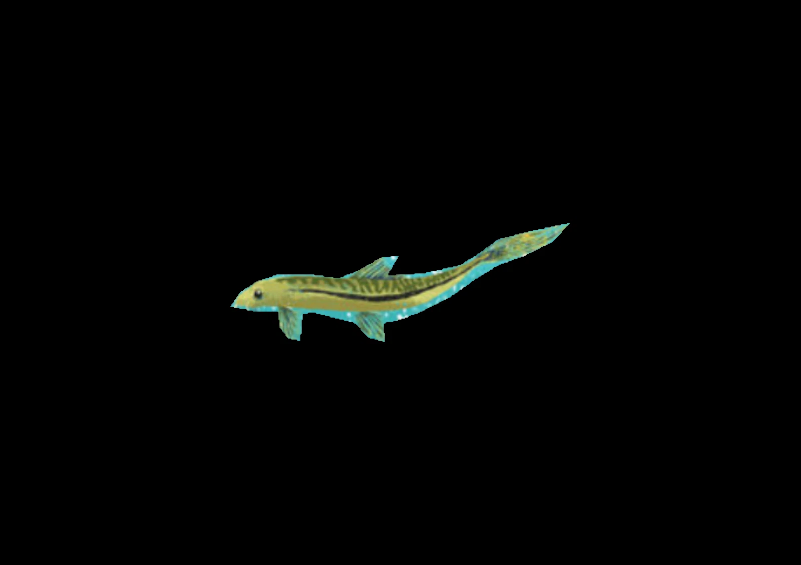
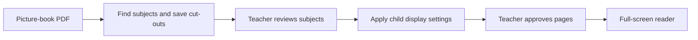
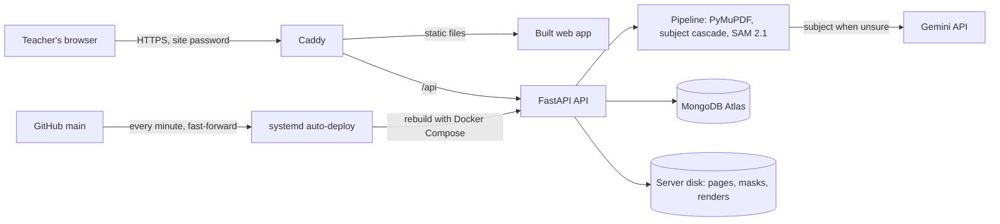

# Miraai

### One book. Different ways to see it.

Picture books adapted for children with **cortical visual impairment (CVI)**, using the book's original artwork and a teacher's approval for every page.

**[Try the live demo](https://miraai.study/)** &nbsp; | &nbsp; [How it works](#what-miraai-does) &nbsp; | &nbsp; [Under the hood](#how-the-project-fits-together) &nbsp; | &nbsp; [Infrastructure](#infrastructure)

Built at HackUMass XIV

---

| Original artwork | Personal display settings | Teacher control |
| :---: | :---: | :---: |
| Cut-outs come directly from the book | Four looks, preferred colors, size, and position | Only approved pages reach the reader |

## Try it in your browser

Open **[Miraai](https://miraai.study/)** (also at [jensenhuangexecutiveboard.vip](https://jensenhuangexecutiveboard.vip/)), choose a book from the library, review its subjects, and set up a child's display preferences. Approve the adapted pages, then open the full-screen reader. You can also upload a picture-book PDF to try the full workflow. The site asks for a password on every page; the team gives it to judges.

## Problem

Children with CVI recognize an object far better when it is shown alone, on a plain background, with strong contrast. Picture-book pages are the opposite. Today a teacher of students with visual impairments (TVI) rebuilds pages by hand, often with scissors and black card, so each child gets only a few adapted books.

## What Miraai does

1. **Upload.** The teacher uploads a PDF picture book.
2. **Find the subject, once.** For each page, an AI model reads the picture and the text together and suggests what the page is about. A segmentation model then traces each suggestion on the original page and saves it as a cut-out.
3. **Subject review.** The teacher confirms the subject, picks a different one, shows several together, clicks the object, or draws an outline by hand. The hand-drawn outline calls no AI, so it works when the AI services are down.
4. **Show it the child's way.** Each child has a profile: a look, preferred colors, background, size, position and text. The same saved cut-out is re-displayed for every child with no new AI work.
5. **Approve, then read.** The teacher approves a contact sheet per child and look. The full-screen reader shows approved pages only, at the teacher's pace.

### One page, four looks

  
   
  <em>The original page from Animal Homes</em>

| Tinted | Cut-out |
| :---: | :---: |
|  |  |
| The subject in the child's preferred color | Original subject colors, less background clutter |

| Faded page | Outlined |
| :---: | :---: |
|  |  |
| Page context with the subject emphasized | Original page with a colored subject outline |

*Example made with the app's manual-outline tool using Animal Homes (PDF page 6), published by Pratham Books on StoryWeaver, CC BY 4.0. Original artwork adapted through cut-outs, tinting, fading, and outlines. These looks are display choices; the teacher decides which to use.*

## What it promises, and what it does not

- **The subject is always copied from the original page.** Nothing is drawn or invented by AI. Tinting, resizing and outlines are display changes on top.
- **A child never sees a version the teacher has not approved.** An approval is tied to one page, one cut-out, one set of profile settings and one look. Change any of them and the reader refuses the page until it is approved again. Change it back and the earlier approval returns.
- **Automatic checks are not approval.** They measure whether the adaptation was built correctly: the cut-out has no stray specks, the background is plain, the subject stands out. Only the teacher decides whether a page is right for a child.
- Miraai does not assess or diagnose CVI, and does not recommend a look.
- No child with CVI has used Miraai yet, and no TVI has reviewed it yet.

## Where AI is used

| Step | Model | Notes |
| --- | --- | --- |
| Choosing the subject | Our own subject model first, then Gemini (Flash), JSON output | Our model answers only when the page is clearly about one thing the page text names; every other page goes to Gemini, so results are as accurate as Gemini alone (see [Our own models](#our-own-models)). Up to 5 suggestions per page with a self-reported confidence. Confidence only screens out weak guesses; when a page has several subjects, the teacher chooses |
| Tracing the cut-out | SAM 2.1 small on CPU | Runs once per suggestion. OpenCV GrabCut is the fallback when PyTorch is not installed. Our own cut-out model can run first (`SEGMENTER=cascade`), but on our CPU server it is no faster than SAM at the same accuracy, so the live site uses SAM |
| Second look | Gemini | Shown only the adapted page, it names the subject. A warning only; it never blocks or grants approval |
| Display and checks | None | NumPy, OpenCV and Pillow. The same input always gives the same picture |

## Our own models

Alongside the off-the-shelf models, the team trained two small models from random weights (no pretrained
weights) during the hackathon, and wired each in front of the big model as a **cascade**: ours answers when it
is sure, the big model takes everything else, and the result stays as accurate as the big model alone.

| Step | Our model | Behind it | On the live site |
| --- | --- | --- | --- |
| Choosing the subject | `subject_model/` (Andrew): a U-Net that finds what stands out on the page and a ResNet-18 that names it | Gemini | **On** (`SUBJECT_FINDER=cascade`) |
| Tracing the cut-out | `cutout_model/` (Kevin and Bryan): a 7.8M-parameter U-Net that turns a box into a mask | SAM 2.1 small | Off (`SEGMENTER=sam2`) |

**Subject cascade.** Our model's answer is kept only when the page rules would pre-select exactly one subject,
the page text names it, and the text is not about anything else (no "and", "&", "or", "with", no other name
our model knows). On *Animal Homes* it answers 1 page of 16 (the crocodile, correctly) in under a second
instead of an 8 to 20 second Gemini call; every other page, including every page it would have got wrong,
goes to Gemini. Accuracy comes first: it is fine that Gemini answers most pages.

**Cut-out model.** Trained on Google Colab (one NVIDIA L4) on DUTS photos, then photos plus drawn cut-outs
pasted on scenes. Scored on 100 held-out drawn test pages against the true masks, with the same box prompt
for every model:

| Model | Mean IoU | Pages under 0.5 | Time per box (L4 GPU) |
| --- | --- | --- | --- |
| GrabCut | 0.776 | 11 | 2.5 s (CPU) |
| SAM 2.1 small | 0.906 | 1 | 0.10 s |
| Ours, photos only | 0.768 | 2 | 0.018 s |
| **Ours, photos and drawings** | **0.897** | **1** | **0.020 s** |

On the real *Animal Homes* boxes it agrees with SAM 2.1 at 0.786 IoU (GrabCut 0.688), and as a cascade it
handles two-thirds of boxes at 0.92 agreement with SAM. It is 2 to 5 times faster than SAM on a GPU, but on
our CPU server SAM studies a page once (about 4 to 5 s) and then cuts each further box in 0.15 s, while our
model takes 0.5 s a box, so the server keeps SAM 2.1. Details: `cutout_model/README.md` and
`pipeline/README.md`.

## Tech stack

- **Web app:** React 18, Vite, TypeScript, Tailwind CSS (`web/`)
- **API:** Python 3.11, FastAPI, Pydantic v2, PyMongo (`api/`, shared types in `contracts/`)
- **Pipeline:** PyMuPDF, Gemini API, SAM 2.1 small (`pipeline/`)
- **Our models:** PyTorch, trained on Google Colab (`cutout_model/`, `subject_model/`)
- **Display and checks:** NumPy, OpenCV, Pillow, WebP output (`render/`, `checks/`)
- **Data:** MongoDB Atlas for records; page images and masks on the server's disk
- **Hosting:** one Vultr instance (6 vCPU, 15 GB RAM, no GPU), Docker Compose, Caddy for HTTPS and the site password, auto-deploy from `main`

The four parts meet at three contracts (the HTTP API, a handful of Python functions and the image file formats), all written down in [Product and technical spec.md](Product%20and%20technical%20spec.md).

## How the project fits together

1. **`web/`** provides the teacher's library, subject editor, child profiles, approval sheet, and full-screen reader.
2. **`api/`** handles uploads, background processing, saved records, and approval checks before serving reader pages.
3. **`pipeline/`** turns PDFs into page images, identifies subjects, and saves masks cut from the original artwork.
4. **`render/` and `checks/`** build each child's adapted view and report technical checks for teacher review.

MongoDB stores records; the filesystem stores page images, masks, and rendered views. Shared interfaces live in `contracts/`, and `infra/` contains deployment automation. Processing happens once per book; saved cut-outs can then be reused across child profiles.

## Infrastructure

| Piece | Where | What it does |
| --- | --- | --- |
| Server | One Vultr VM, 6 vCPU, 15 GB RAM, 300 GB disk, CPU only | Runs everything below in Docker Compose |
| Addresses | [miraai.study](https://miraai.study/), www.miraai.study, jensenhuangexecutiveboard.vip | Caddy gets Let's Encrypt certificates for each name |
| Caddy | `Caddyfile`, `infra/caddy.Dockerfile` | HTTPS, a password on every path, the built web app, and `/api` forwarded to the API. Refuses to start without a password |
| API and pipeline | `Dockerfile` (Python 3.11) | FastAPI, background processing of up to 4 pages at a time, SAM 2.1 and both of our models on CPU |
| Database | MongoDB Atlas | Books, pages, profiles, approvals, checks. A local `mongo` container is the fallback when no Atlas address is set |
| Files | `/opt/mirai/data` on the server, mounted into the API | Page images, masks and renders; survive restarts and rebuilds |
| Deploys | `infra/autodeploy.sh`, a systemd timer | Every minute it checks `main`; when it moved, it fast-forwards and rebuilds. A failed build leaves the old version serving, so **merging to `main` is deploying** |

Settings live in the server's `.env`, never in git: the site password, the Gemini key, the Atlas address,
`SEGMENTER=sam2` and `SUBJECT_FINDER=cascade`. The runbook (deploy, check, roll back, pause auto-deploy) is in
[infra/DEPLOY.md](infra/DEPLOY.md).

## Validation

The project includes Python and frontend tests covering the API contracts, segmentation and display behavior, teacher review, and the reader's approval rules. Reader tests check that unapproved pages are refused and that changes to a profile, subject, or render version require approval again.

## Measured so far

- A 5-page book (*Animal Homes*) processes in about 30 seconds on a laptop with the real Gemini calls, 4 pages at a time, using GrabCut cut-outs.
- One Gemini subject call takes 7.6 to 12.9 seconds and about 1,500 input tokens.
- Switching child or look needs no AI call; it re-displays the saved cut-out.
- On the live server (6 vCPU, no GPU), SAM 2.1 takes about 4 to 5 seconds for a page's first cut-out and 0.15 seconds for each further one. The first cut-out after a server restart takes about 24 seconds while the model loads.
- The 16-page *Animal Homes* runs through the whole pipeline in about 65 seconds on a laptop with Gemini.
- Our subject model answers a page in under a second on the server; a Gemini call takes 8 to 20 seconds.
- Our cut-out model scores 0.897 mean IoU on 100 held-out drawn pages against SAM 2.1's 0.906, 5 times faster on a GPU (see [Our own models](#our-own-models)).

**Evaluation is not run yet.** The plan is a set of 20 StoryWeaver pages, hand-labeled before any AI output is seen and never used for tuning, reported as counts: correct subjects, correctly flagged pages, confidently wrong pages and cut-out defects.

## Data and attribution

- Demo book: *Animal Homes*, published by Pratham Books on StoryWeaver, CC BY 4.0. Miraai keeps each book's credits and license on a credits screen at the end of the reader, with a note that the pages were adapted.
- Text font: Atkinson Hyperlegible, SIL Open Font License (`render/fonts/OFL.txt`).
- Our models were trained from random weights on DUTS (Wang et al., CVPR 2017; research use), anime-segmentation (skytnt, CC0) and DomainNet (Peng et al., ICCV 2019; non-commercial research and education). Test pages come from Pratham Books' StoryWeaver, CC BY 4.0.
- The demo children, Maya and Leo, are fictional. No real child's data is stored.
- Book pages are sent to an outside AI service (Gemini) to find the subject. The upload screen says so.

## Team

| Person | Part | Folders |
| --- | --- | --- |
| Bryan | Pipeline and server | `pipeline/`, `fixtures/`, `infra/`, `Dockerfile`, `compose.yaml`, `Caddyfile` |
| Kevin | Display, checks, pitch, and the cut-out model code (with Bryan) | `render/`, `checks/`, `pitch/`, `tests/`, `cutout_model/` |
| Andrew | API, data, and the subject model | `api/`, `contracts/`, `subject_model/` |
| Thomas | Web app | `web/` |
