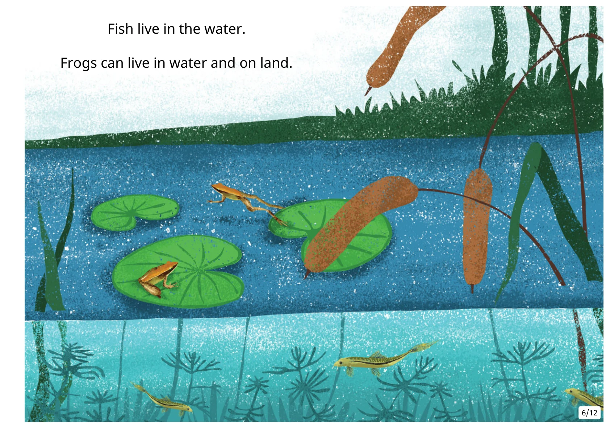
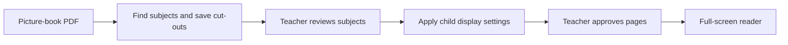
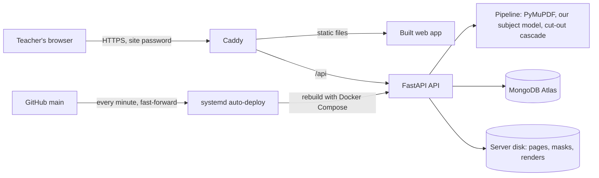

# Miraai

### One book. Different ways to see it.

Picture books adapted for children with **cortical visual impairment (CVI)**, using the book's original artwork and a teacher's approval for every page.

**[Try the live demo](https://miraai.study/)** &nbsp; | &nbsp; [How it works](#what-miraai-does) &nbsp; | &nbsp; [Under the hood](#how-the-project-fits-together) &nbsp; | &nbsp; [Our own models](#our-own-models) &nbsp; | &nbsp; [Infrastructure](#infrastructure)

Built at HackUMass XIV

---

| Original artwork | Personal display settings | Teacher control |
| :---: | :---: | :---: |
| Cut-outs come directly from the book | Four looks, preferred colors, size, and position | Only approved pages reach the reader |

## Try it in your browser

Open **[Miraai](https://miraai.study/)** (also at [jensenhuangexecutiveboard.vip](https://jensenhuangexecutiveboard.vip/)), choose a book from the library, review its subjects, and set up a child's display preferences. Approve the adapted pages, then open the full-screen reader. You can also upload a picture-book PDF to try the full workflow. The site asks for a password on every page; the team gives it to judges.

## Problem

Children with CVI recognize an object far better when it is shown alone, on a plain background, with strong contrast. Picture-book pages are the opposite. Today a teacher of students with visual impairments (TVI) rebuilds pages by hand, often with scissors and black card, so each child gets only a few adapted books.

## What Miraai does

1. **Upload.** The teacher uploads a PDF picture book.
2. **Find the subject, once.** For each page, an AI model reads the picture and the text together and suggests what the page is about. A segmentation model then traces each suggestion on the original page and saves it as a cut-out.
3. **Subject review.** The teacher confirms the subject, picks a different one, shows several together, clicks the object, or draws an outline by hand. The hand-drawn outline calls no AI, so it works when the AI services are down.
4. **Show it the child's way.** Each child has a profile: a look, preferred colors, background, size, position and text. The same saved cut-out is re-displayed for every child with no new AI work.
5. **Approve, then read.** The teacher approves a contact sheet per child and look. The full-screen reader shows approved pages only, at the teacher's pace.

### One page, four looks

  
   
  <em>The original page from Animal Homes</em>

| Tinted | Cut-out |
| :---: | :---: |
|  |  |
| The subject in the child's preferred color | Original subject colors, less background clutter |

| Faded page | Outlined |
| :---: | :---: |
|  |  |
| Page context with the subject emphasized | Original page with a colored subject outline |

*Example made with the app's manual-outline tool using Animal Homes (PDF page 6), published by Pratham Books on StoryWeaver, CC BY 4.0. Original artwork adapted through cut-outs, tinting, fading, and outlines. These looks are display choices; the teacher decides which to use.*

## What it promises, and what it does not

- **The subject is always copied from the original page.** Nothing is drawn or invented by AI. Tinting, resizing and outlines are display changes on top.
- **A child never sees a version the teacher has not approved.** An approval is tied to one page, one cut-out, one set of profile settings and one look. Change any of them and the reader refuses the page until it is approved again. Change it back and the earlier approval returns.
- **Automatic checks are not approval.** They measure whether the adaptation was built correctly: the cut-out has no stray specks, the background is plain, the subject stands out. Only the teacher decides whether a page is right for a child.
- Miraai does not assess or diagnose CVI, and does not recommend a look.
- No child with CVI has used Miraai yet, and no TVI has reviewed it yet.

## Where AI is used

| Step | Model | Notes |
| --- | --- | --- |
| Choosing the subject | **Our own subject model**, on our server | Up to 5 suggestions per page. A suggestion is pre-selected only when the page is clearly about one thing the page text names; on every other page our guesses are offered and the teacher picks, clicks or outlines the subject (see [Our own models](#our-own-models)). No outside AI service is called |
| Tracing the cut-out | **Our own cut-out model first**, then SAM 2.1 small on CPU | Our model, trained from scratch, cuts each suggestion first and keeps its mask only when its confidence checks score at least 0.75; otherwise SAM 2.1 cuts it. Clicks always go to SAM. OpenCV GrabCut is the last fallback (see [Our own models](#our-own-models)) |
| Second look | Our namer | Shown only the adapted page, it names the subject. It is the same namer that suggests labels, so it mostly matters when the teacher typed or changed the label. A warning only; it never blocks or grants approval |
| Display and checks | None | NumPy, OpenCV and Pillow. The same input always gives the same picture |

## Our own models

The team trained two small models **from scratch** (random starting weights, no pretrained
weights anywhere) during the hackathon. Since 2026-11-15 every AI step runs on our own server:
no page is sent to an outside AI service.

| Step | Our model (trained from scratch) | Behind it | Setting | On the live site |
| --- | --- | --- | --- | --- |
| Choosing the subject | `subject_model/` (Andrew): a finder U-Net and a namer ResNet-18 | The teacher, whenever the trust check fails | none | **On** |
| Tracing the cut-out | `cutout_model/` (Kevin and Bryan): a 7.8M-parameter U-Net | SAM 2.1 small, then GrabCut | `SEGMENTER=cascade`, `CASCADE_MIN_CONFIDENCE=0.75` | **On** |

Every decision is logged with the reason (`subjects.last_subject_route()`, `cascade.last_route()`),
so you can see why each page was pre-selected or left to the teacher, and which model cut it out.

### Choosing the subject

**Our model.** Two networks that together return up to five subjects, each with a name, a box
and a confidence:

- **Finder:** a half-width U-Net (16 to 256 channels) that marks what stands out on a page.
  Trained for 37 epochs at 256 px on DUTS-TR (10,025 photos with hand-drawn masks; 3 in 10 placed
  on paper with printed words so it learns to ignore text). Validation IoU 0.827.
- **Namer:** a ResNet-18 that names each blob with one of 347 names. Trained for 30 epochs at
  128 px on DomainNet clipart, painting and sketch (181,092 training images) plus person and
  text examples. Validation top-1 accuracy 0.590.
- The page's own text then confirms or rejects each name.

**The trust check.** A suggestion is pre-selected only when all three hold; otherwise the page
asks the teacher, with our suggestions offered one click away:

1. the page's own rules (`decide_state`) would pre-select **exactly one** subject;
2. the page text **names** that subject;
3. the text is **not about anything else**: no "and", "&", "or" or "with", and no other name
   our model knows.

Checks 1 and 2 came from measuring: without them our model pre-selected a wrong cut-out on 4 of
7 pages it marked Ready (the whole pond, a burrow, printed text, a banner). Check 3 came from
*Animal Homes* page 11, "Deer live in forests. And so do tigers!", where our model chose the
tiger and never offered the deer.

**How good it is.** On 38 team-labelled pages with 121 subjects, our model finds 17 of the
subjects (Gemini Flash, which the app used until 2026-11-15, found 73 of 114) and pre-selected a
wrong subject on none. So the teacher picks the subject on most pages, by choosing a suggestion,
clicking the object, or outlining it. Accuracy comes first: a page that asks is safe, a wrong
pre-selection is not. 

On *Animal Homes* (16 pages, measured 2026-11-15) one page comes back Ready, and it is right
(page 10, the crocodile). The other 15 ask the teacher; on 6 of them the trust check held back a
single guess, 4 of which were wrong (pages 6, 7, 12 and 16) and 2 right but on pages about two
things (the bear and the tiger, whose page text also names wolves and deer). No page failed.

### Tracing the cut-out: the model cascade (live)

Our cut-out model tries first; a strict check decides whether to keep its mask, and SAM 2.1 cuts
every box it is unsure of.

**Our model.** A U-Net with 7.8M parameters that takes a 320 px crop around a subject's box
(red, green, blue, plus one channel marking the box) and returns that subject's mask. Like every
cut-out in Miraai, the subject is then copied from the original page through the mask; the model
never draws. Trained on Google Colab on one NVIDIA L4:

- **Run A:** DUTS-TR photos with hand-drawn masks, 27 epochs, about 1 hour.
- **Run B:** the same photos plus as many drawn cut-outs (anime-segmentation) pasted onto scenes,
  where each mask comes free from the cut-out's transparency, 16 epochs from run A's best,
  about 72 minutes. No mask anywhere was made by SAM.

Scored on 100 held-out drawn test pages (built from archives never used in training) against
the true masks, with the same box prompt for every model:

| Model | Mean IoU | Pages under 0.5 | Time per box (L4 GPU) |
| --- | --- | --- | --- |
| GrabCut | 0.776 | 11 | 2.5 s (CPU) |
| SAM 2.1 small | 0.906 | 1 | 0.10 s |
| Ours, run A (photos) | 0.768 | 2 | 0.018 s |
| **Ours, run B (photos and drawings)** | **0.897** | **1** | **0.020 s** |

On the 36 real subject boxes of *Animal Homes* (no hand masks there, so this is agreement with
SAM, not accuracy) it agrees with SAM 2.1 at 0.786 IoU, against 0.688 for GrabCut, and finds 5
small subjects GrabCut misses entirely.

**The trust check.** A confidence score, the lowest of five checks on our own mask, so a low
score always names the reason:

- **sure:** how decided the model is along the mask's outline;
- **fill:** the mask fills a sensible share of its box, neither a speck nor the whole box;
- **pieces:** most of the mask is one piece;
- **border:** the mask does not fill the box's edge band (that means background);
- **mirror:** the model draws the same outline when the crop is mirrored. A model that is sure of
  a subject agrees with itself either way round. Because the score is the lowest check, the
  mirror pass only runs when the other four already clear the bar.

Under the threshold, the box goes to SAM 2.1. Clicks always go to SAM, because our model only
takes boxes.

**Calibration.** `python -m pipeline.calibrate_cascade` tries every threshold on real boxes and
picks the one that keeps the most boxes on our model while staying within a margin of SAM. On
*Animal Homes*:

| Threshold | Boxes cut by our model | Agreement with SAM 2.1 |
| --- | --- | --- |
| our model alone | 100% | 0.786 |
| 0.60 | 78% | 0.890 |
| **0.65 (default)** | **67%** | **0.919** |
| 0.70 | 53% | 0.948 |
| **0.75 (live)** | **42%** | **0.967** |
| SAM alone | 0% | 1.000 |

Without the mirror check, the best setting keeps only 53% of boxes at the same agreement, so the
mirror check makes our model a better judge of its own masks.

**On the live server.** The cut-out cascade is on with a stricter threshold than the
calibrated default: 0.75 instead of 0.65. Accuracy comes first, so our model keeps only the
masks it is most sure of: on *Animal Homes* that is about 42% of boxes, at 0.967 agreement with
SAM, and SAM cuts everything else. Our model needs no outside service and is 2 to 5 times faster
than SAM on a GPU. The server has no GPU: on its 6 CPUs, SAM studies a page once (about 4 to 5 s)
and then cuts each further box on that page in 0.15 s, while our model takes 0.5 s a box, so
there the cascade runs at about SAM's speed rather than faster. Rollback: `SEGMENTER=sam2`.

**Where to look.** `pipeline/cascade.py` and `pipeline/calibrate_cascade.py` (cut-outs),
`pipeline/subjects.py` (subjects), `cutout_model/README.md` and `subject_model/README.md` (training
and full results), `pipeline/README.md` (settings and rollback).

## Tech stack

- **Web app:** React 18, Vite, TypeScript, Tailwind CSS (`web/`)
- **API:** Python 3.11, FastAPI, Pydantic v2, PyMongo (`api/`, shared types in `contracts/`)
- **Pipeline:** PyMuPDF, our subject model, our cut-out model and SAM 2.1 small (`pipeline/`)
- **Our models:** PyTorch, trained on Google Colab (`cutout_model/`, `subject_model/`)
- **Display and checks:** NumPy, OpenCV, Pillow, WebP output (`render/`, `checks/`)
- **Data:** MongoDB Atlas for records; page images and masks on the server's disk
- **Hosting:** one Vultr instance (6 vCPU, 15 GB RAM, no GPU), Docker Compose, Caddy for HTTPS and the site password, auto-deploy from `main`

The four parts meet at three contracts (the HTTP API, a handful of Python functions and the image file formats), all written down in [Product and technical spec.md](Product%20and%20technical%20spec.md).

## How the project fits together

1. **`web/`** provides the teacher's library, subject editor, child profiles, approval sheet, and full-screen reader.
2. **`api/`** handles uploads, background processing, saved records, and approval checks before serving reader pages.
3. **`pipeline/`** turns PDFs into page images, identifies subjects, and saves masks cut from the original artwork.
4. **`render/` and `checks/`** build each child's adapted view and report technical checks for teacher review.

MongoDB stores records; the filesystem stores page images, masks, and rendered views. Shared interfaces live in `contracts/`, and `infra/` contains deployment automation. Processing happens once per book; saved cut-outs can then be reused across child profiles.

## Infrastructure

| Piece | Where | What it does |
| --- | --- | --- |
| Server | One Vultr VM, 6 vCPU, 15 GB RAM, 300 GB disk, CPU only | Runs everything below in Docker Compose |
| Addresses | [miraai.study](https://miraai.study/), www.miraai.study, jensenhuangexecutiveboard.vip | Caddy gets Let's Encrypt certificates for each name |
| Caddy | `Caddyfile`, `infra/caddy.Dockerfile` | HTTPS, a password on every path, the built web app, and `/api` forwarded to the API. Refuses to start without a password |
| API and pipeline | `Dockerfile` (Python 3.11) | FastAPI, background processing of up to 4 pages at a time, both of our models and SAM 2.1 behind them, all on CPU |
| Database | MongoDB Atlas | Books, pages, profiles, approvals, checks. A local `mongo` container is the fallback when no Atlas address is set |
| Files | `/opt/mirai/data` on the server, mounted into the API | Page images, masks and renders; survive restarts and rebuilds |
| Deploys | `infra/autodeploy.sh`, a systemd timer | Every minute it checks `main`; when it moved, it fast-forwards and rebuilds. A failed build leaves the old version serving, so **merging to `main` is deploying** |

Settings live in the server's `.env`, never in git: the site password, the Atlas address, and
`SEGMENTER=cascade` with `CASCADE_MIN_CONFIDENCE=0.75`. There is no AI key: nothing leaves the server. The runbook (deploy, check, roll back, pause auto-deploy) is in
[infra/DEPLOY.md](infra/DEPLOY.md).

## Validation

The project includes Python and frontend tests covering the API contracts, segmentation and display behavior, teacher review, and the reader's approval rules. Reader tests check that unapproved pages are refused and that changes to a profile, subject, or render version require approval again.

## Measured so far

- The 16-page *Animal Homes* runs through the whole pipeline in 93 seconds on a laptop CPU, 4 pages at a time, with our subject model and the cut-out cascade, and no outside calls.
- Switching child or look needs no AI call; it re-displays the saved cut-out.
- On the live server (6 vCPU, no GPU), SAM 2.1 takes about 4 to 5 seconds for a page's first cut-out and 0.15 seconds for each further one. The first cut-out after a server restart takes about 24 seconds while the model loads.
- Our subject model answers a page in under a second on the server. Gemini, which the app used until 2026-11-15, took 8 to 20 seconds a call.
- Our cut-out model scores 0.897 mean IoU on 100 held-out drawn pages against SAM 2.1's 0.906, 5 times faster on a GPU (see [Our own models](#our-own-models)).

**Evaluation is not run yet.** The plan is a set of 20 StoryWeaver pages, hand-labeled before any AI output is seen and never used for tuning, reported as counts: correct subjects, correctly flagged pages, confidently wrong pages and cut-out defects.

## Data and attribution

- Demo book: *Animal Homes*, published by Pratham Books on StoryWeaver, CC BY 4.0. Miraai keeps each book's credits and license on a credits screen at the end of the reader, with a note that the pages were adapted.
- Text font: Atkinson Hyperlegible, SIL Open Font License (`render/fonts/OFL.txt`).
- Our models were trained from random weights on DUTS (Wang et al., CVPR 2017; research use), anime-segmentation (skytnt, CC0) and DomainNet (Peng et al., ICCV 2019; non-commercial research and education). Test pages come from Pratham Books' StoryWeaver, CC BY 4.0.
- The demo children, Maya and Leo, are fictional. No real child's data is stored.
- Book pages never leave our server: every model runs there. Until 2026-11-15 pages were sent to Gemini to find the subject.

## Team

| Person | Part | Folders |
| --- | --- | --- |
| Bryan | Pipeline and server | `pipeline/`, `fixtures/`, `infra/`, `Dockerfile`, `compose.yaml`, `Caddyfile` |
| Kevin | Display, checks, pitch, and the cut-out model code (with Bryan) | `render/`, `checks/`, `pitch/`, `tests/`, `cutout_model/` |
| Andrew | API, data, and the subject model | `api/`, `contracts/`, `subject_model/` |
| Thomas | Web app | `web/` |
