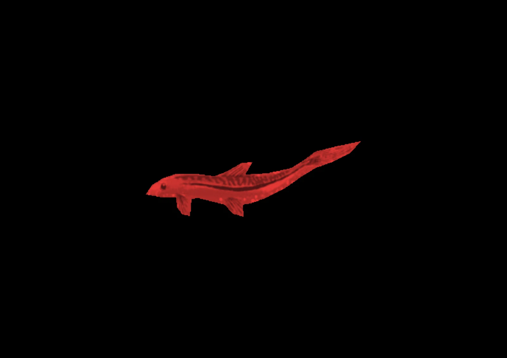
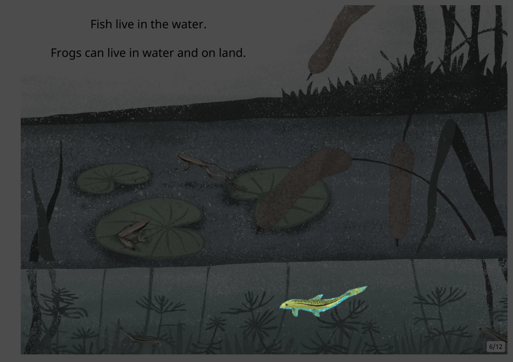
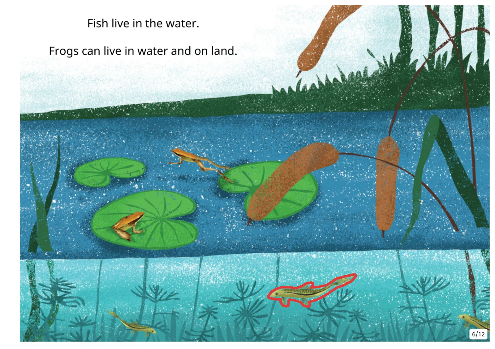
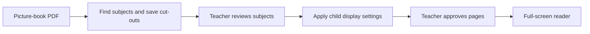

# Miraai

### One book. Different ways to see it.

Picture books adapted for children with **cortical visual impairment (CVI)**, using the book's original artwork and a teacher's approval for every page.

**[Try the live demo](https://jensenhuangexecutiveboard.vip/)** &nbsp; | &nbsp; [How it works](#what-miraai-does) &nbsp; | &nbsp; [Under the hood](#how-the-project-fits-together)

Built at HackUMass XIV

---

| Original artwork | Personal display settings | Teacher control |
| :---: | :---: | :---: |
| Cut-outs come directly from the book | Four looks, preferred colors, size, and position | Only approved pages reach the reader |

## Try it in your browser

Open **[Miraai](https://jensenhuangexecutiveboard.vip/)**, choose a book from the library, review its subjects, and set up a child's display preferences. Approve the adapted pages, then open the full-screen reader. You can also upload a picture-book PDF to try the full workflow.

## Problem

Children with CVI recognize an object far better when it is shown alone, on a plain background, with strong contrast. Picture-book pages are the opposite. Today a teacher of students with visual impairments (TVI) rebuilds pages by hand, often with scissors and black card, so each child gets only a few adapted books.

## What Miraai does

1. **Upload.** The teacher uploads a PDF picture book.
2. **Find the subject, once.** For each page, an AI model reads the picture and the text together and suggests what the page is about. A segmentation model then traces each suggestion on the original page and saves it as a cut-out.
3. **Subject review.** The teacher confirms the subject, picks a different one, shows several together, clicks the object, or draws an outline by hand. The hand-drawn outline calls no AI, so it works when the AI services are down.
4. **Show it the child's way.** Each child has a profile: a look, preferred colors, background, size, position and text. The same saved cut-out is re-displayed for every child with no new AI work.
5. **Approve, then read.** The teacher approves a contact sheet per child and look. The full-screen reader shows approved pages only, at the teacher's pace.

### One page, four looks

  
   
  <em>The original page from Animal Homes</em>

| Tinted | Cut-out |
| :---: | :---: |
|  |  |
| The subject in the child's preferred color | Original subject colors, less background clutter |

| Faded page | Outlined |
| :---: | :---: |
|  |  |
| Page context with the subject emphasized | Original page with a colored subject outline |

*Example made with the app's manual-outline tool using Animal Homes (PDF page 6), published by Pratham Books on StoryWeaver, CC BY 4.0. Original artwork adapted through cut-outs, tinting, fading, and outlines. These looks are display choices; the teacher decides which to use.*

## What it promises, and what it does not

- **The subject is always copied from the original page.** Nothing is drawn or invented by AI. Tinting, resizing and outlines are display changes on top.
- **A child never sees a version the teacher has not approved.** An approval is tied to one page, one cut-out, one set of profile settings and one look. Change any of them and the reader refuses the page until it is approved again. Change it back and the earlier approval returns.
- **Automatic checks are not approval.** They measure whether the adaptation was built correctly: the cut-out has no stray specks, the background is plain, the subject stands out. Only the teacher decides whether a page is right for a child.
- Miraai does not assess or diagnose CVI, and does not recommend a look.
- No child with CVI has used Miraai yet, and no TVI has reviewed it yet.

## Where AI is used

| Step | Model | Notes |
| --- | --- | --- |
| Choosing the subject | Gemini (Flash), JSON output | Up to 5 suggestions per page with a self-reported confidence. Confidence only screens out weak guesses; when a page has several subjects, the teacher chooses |
| Tracing the cut-out | SAM 2.1 small on CPU | Runs once per suggestion. OpenCV GrabCut is the fallback when PyTorch is not installed |
| Second look | Gemini | Shown only the adapted page, it names the subject. A warning only; it never blocks or grants approval |
| Display and checks | None | NumPy, OpenCV and Pillow. The same input always gives the same picture |

## Tech stack

- **Web app:** React 18, Vite, TypeScript, Tailwind CSS (`web/`)
- **API:** Python 3.11, FastAPI, Pydantic v2, PyMongo (`api/`, shared types in `contracts/`)
- **Pipeline:** PyMuPDF, Gemini API, SAM 2.1 small (`pipeline/`)
- **Display and checks:** NumPy, OpenCV, Pillow, WebP output (`render/`, `checks/`)
- **Data:** MongoDB for records; page images and masks on disk
- **Hosting:** one Vultr instance, Docker Compose, Caddy for HTTPS and the site password

The four parts meet at three contracts (the HTTP API, a handful of Python functions and the image file formats), all written down in [Product and technical spec.md](Product%20and%20technical%20spec.md).

## How the project fits together

1. **`web/`** provides the teacher's library, subject editor, child profiles, approval sheet, and full-screen reader.
2. **`api/`** handles uploads, background processing, saved records, and approval checks before serving reader pages.
3. **`pipeline/`** turns PDFs into page images, identifies subjects, and saves masks cut from the original artwork.
4. **`render/` and `checks/`** build each child's adapted view and report technical checks for teacher review.

MongoDB stores records; the filesystem stores page images, masks, and rendered views. Shared interfaces live in `contracts/`, and `infra/` contains deployment automation. Processing happens once per book; saved cut-outs can then be reused across child profiles.

## Validation

The project includes Python and frontend tests covering the API contracts, segmentation and display behavior, teacher review, and the reader's approval rules. Reader tests check that unapproved pages are refused and that changes to a profile, subject, or render version require approval again.

## Measured so far

- A 5-page book (*Animal Homes*) processes in about 30 seconds on a laptop with the real Gemini calls, 4 pages at a time, using GrabCut cut-outs.
- One Gemini subject call takes 7.6 to 12.9 seconds and about 1,500 input tokens.
- Switching child or look needs no AI call; it re-displays the saved cut-out.

**Evaluation is not run yet.** The plan is a set of 20 StoryWeaver pages, hand-labeled before any AI output is seen and never used for tuning, reported as counts: correct subjects, correctly flagged pages, confidently wrong pages and cut-out defects.

## Data and attribution

- Demo book: *Animal Homes*, published by Pratham Books on StoryWeaver, CC BY 4.0. Miraai keeps each book's credits and license on a credits screen at the end of the reader, with a note that the pages were adapted.
- Text font: Atkinson Hyperlegible, SIL Open Font License (`render/fonts/OFL.txt`).
- The demo children, Maya and Leo, are fictional. No real child's data is stored.
- Book pages are sent to an outside AI service (Gemini) to find the subject. The upload screen says so.

## Team

| Person | Part | Folders |
| --- | --- | --- |
| Bryan | Pipeline and server | `pipeline/`, `fixtures/`, `infra/`, `Dockerfile`, `compose.yaml`, `Caddyfile` |
| Kevin | Display, checks, pitch, and the cut-out model code (with Bryan) | `render/`, `checks/`, `pitch/`, `tests/`, `cutout_model/` |
| Andrew | API and data | `api/`, `contracts/` |
| Thomas | Web app | `web/` |
